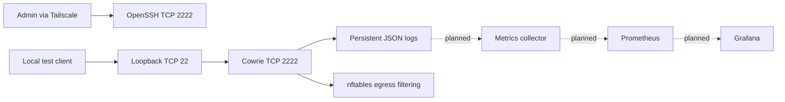

# Architecture

The administrative SSH service is managed separately. The firewall rules filter new IP connections arriving from br-honeypot; they do not prove DNS or container escape containment. Keep the sensor loopback-only. Future metrics should avoid raw IP, username, password and command labels to prevent sensitive data exposure and high cardinality.
